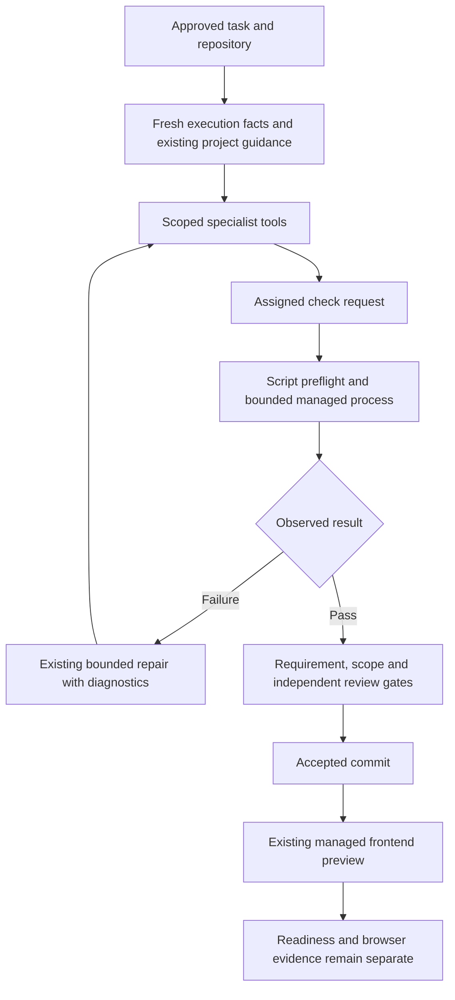

# Orchestration and AI execution redesign

Updated: 29 October 2026 (Asia/Manila).
Status: implemented and validated locally in `alpha-be-execution-redesign`; not activated in the running desktop.

## Scope and corrected baseline

This document replaces the earlier draft in this chat. That draft combined the old `alpha-be-main` checkout with newer worktrees and incorrectly described several implemented features as missing. It also treated possible explanations of localhost failures as proven causes without tracing an actual failed user run.

The implementation baseline is backend commit `383ff7d3e9a317b9c00bd46ba12d62f1f14b2cca` plus the existing local preview/chat work from `release-be-2.0.59`. Those local changes were copied into the isolated branch and recorded separately as `3c02196`. The source checkout was left intact. The new branch is `feat/orchestration-execution-20261028`.

Verified in that source:

- Orchestrated specialists already use scoped task MCP tools. Native file writes and terminal commands are disabled through the provider adapters.
- The platform already discovers package verification scripts, executes checks, preserves structured reports and scope evidence, and limits automatic repair attempts.
- Project playbooks already supply ALPHA.md, AGENTS.md or CLAUDE.md plus detected stack information.
- The copied preview integration already starts previews from accepted frontend checkpoints and binds the preview to the accepted commit.
- Security remains the independent lead reviewer; the Orchestrator owns sequencing and recovery decisions.

The additional issues discussed in the last review (role consolidation, wider workspace redesign, and report schema replacement) are outside this implementation.

## Target execution flow

## Phase 1: Bounded checks — implemented

Files: `src/services/repositoryExecution.ts`, `verificationService.ts`, `processManager.ts`.

1. Keep the existing scoped tool boundary. Do not add a fictitious universal Bash interceptor to a provider CLI.
2. Inspect selected package scripts before dependency preparation or execution. Detect common servers/watchers, background ampersands, cyclic local script aliases, and pre/post check hooks.
3. Bound inspection by script size, recursion depth and total alias visits. Preserve ordinary bounded builds, CI tests, quoted output and standard stderr redirection.
4. Run managed verification with `CI=true` and a five-minute per-process wall-clock deadline. A caller may shorten the global process deadline, never extend it. The existing process-tree termination machinery handles timeout.
5. Preserve timeout/failure semantics even if a child exits with code zero after forced termination.
6. Missing required scripts fail preflight; they cannot be labelled passed. No configured conventional scripts remains skipped/unverified.
7. Prevent the stale-metadata dependency retry when cancellation has been requested.

This preflight catches common operational mistakes. It is not an OS sandbox or a complete shell parser. Arbitrary JavaScript, external wrappers and detached child processes require separate containment guarantees; the test below proves cleanup for the attached npm/node process tree only. Existing install lifecycle behavior remains, with managed deadlines; this change does not claim that repository scripts are inherently trusted or safe.

## Phase 2: Fresh repository grounding — implemented

Files: `repositoryExecution.ts`, `projectPlaybook.ts`, `runnerService.ts`.

- Share package-manager selection and command discovery between the executor and the context shown to agents.
- Prefer an explicit supported `packageManager` declaration, then supported lockfiles, then the existing npm fallback.
- Show the actual registered command names, unavailable checks, OS, tool boundary, checkpoint ownership and preview responsibility.
- Re-read execution facts from the assigned repository before every orchestration attempt; do not rely only on the original planning snapshot.
- Preserve human project guidance and role responsibilities. Do not promise complete repository knowledge from a small manifest.
- Report-only corrections remain report-only; they do not receive a new execution-context read from this addition.
- Unsupported ecosystems do not receive invented npm instructions.

The task tool still accepts only the task's assigned check names. Listing a conventional command in context grants no additional authority.

## Phase 3: Managed previews — reused and regression-tested

Existing files: `acceptedWebsitePreview.ts`, `localPreviewService.ts`, `localPreviewCheckpoint.test.ts`, `acceptedWebsitePreview.test.ts`.

- Accepted frontend changes can start a preview pinned to their accepted commit.
- Report-only, failed, cancelled and backend-only cases do not acquire this behavior.
- Duplicate acceptance delivery does not need a second preview.
- A moved worktree HEAD cannot silently replace the accepted commit.
- Existing preview authorization and lifecycle rules remain authoritative.

No new preview engine or desktop restart was required for this source change. Native Electron rendering was not re-tested in this run; the current tests cover service behavior and checkpoint selection.

## Phase 4: Verification and repair — preserved and tested

Existing `orchestrationService.ts`, `orchestrationRecoveryPolicy.ts`, `taskAcceptanceService.ts` already route failed verification evidence back to the assigned specialist and stop at the configured repair limit.

- Retain observed output and pass/fail status as execution evidence.
- Retain structured task reports for requirement coverage, handoffs and review findings.
- Passing a compiler/test suite alone does not prove that the requested feature works.
- Preserve independent review, scope enforcement, accepted artifacts and publication approval.
- Verify existing retry limits, targeted repair routing and late-result handling through their regression tests.

## Validation evidence

See [verification record](verification/orchestration-execution/VERIFICATION.md) in the implementation checkout.

- Baseline: 51 tests passed before changes.
- Red phase: all 15 newly added regression cases failed against the old implementation.
- Broad regression: 276 tests passed across 16 files after the implementation.
- Follow-up: 40 tests passed after adding real runner prompt assertions, newline coverage and an output-active deadline test.
- Final preflight/runtime checks: 34 tests passed, including additional bounded-command compatibility cases.
- Production TypeScript build passed.
- Real fixture: a failing command returned actual stderr; after editing the fixture, the next execution passed.
- Real fixture: an opaque npm script served HTTP on an OS-assigned loopback port; the managed deadline stopped the process tree, returned failure and released the port.

Provider invocation policy tests are automated adapter tests, not live calls to every AI provider. No paid model evaluation, deployed application check or end-user workflow success rate was measured. These results establish local implementation behavior, not that every reported orchestration problem has been reproduced or eliminated.

## Rollout

1. Review the isolated branch relative to `3c02196` to see only the redesign changes; the preceding commit preserves the prior local integration baseline.
2. Integrate into the intended current backend branch while preserving the preview/chat work.
3. Build the matching desktop with explicit backend/frontend source paths, then activate it when appropriate.
4. Run a representative real model task and observe assigned checks, repair routing and preview delivery before claiming deployed improvement.

No workflows, provider credentials, live project data or running desktop processes were changed.
